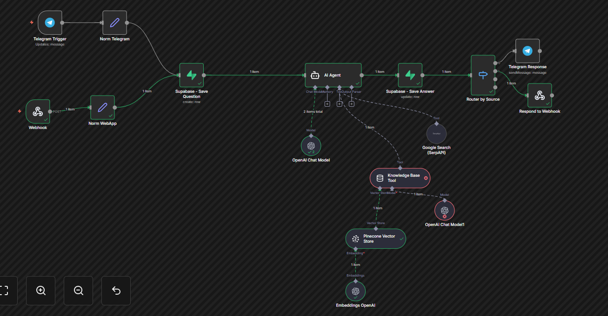
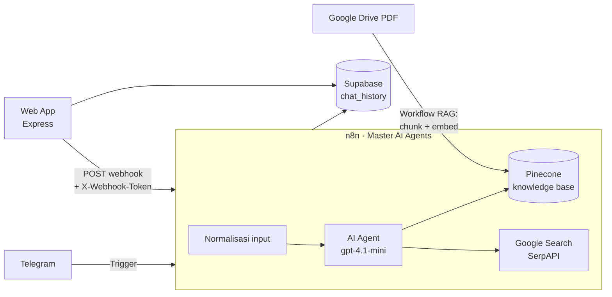

# Honda AI Customer Service — RAG Chatbot

Asisten virtual untuk showroom Honda yang menjawab pertanyaan seputar produk, harga, dan spesifikasi mobil. Jawaban diambil dari knowledge base sendiri lewat **Retrieval-Augmented Generation (RAG)**, dan bisa diakses dari **Telegram** maupun **web app**.



## Fitur

- **Dua kanal, satu otak.** Telegram bot dan web app sama-sama diproses oleh satu workflow utama di n8n (*Master AI Agents*).
- **RAG dengan Pinecone.** Dokumen PDF dari Google Drive dipecah (chunk 500 karakter), di-embed dengan `text-embedding-3-small`, lalu disimpan di Pinecone (1536 dimensi, cosine).
- **AI Agent dengan tool.** Agent (`gpt-4.1-mini`) wajib mencari di knowledge base dulu, dan baru memakai Google Search (SerpAPI) kalau datanya tidak ada.
- **Akun & riwayat chat.** Register/login dengan password ber-hash bcrypt, riwayat percakapan per sesi disimpan di Supabase.
- **Deploy-ready.** n8n di Docker, web app bisa jalan sebagai server Node biasa atau di Vercel.

## Arsitektur



## Tech Stack

| Bagian | Teknologi |
|---|---|
| Orkestrasi & AI | n8n, OpenAI (`gpt-4.1-mini`, `text-embedding-3-small`), SerpAPI |
| Vector database | Pinecone |
| Backend web | Node.js, Express 5, express-session, bcryptjs |
| Database | Supabase (PostgreSQL + Row Level Security) |
| Frontend | HTML, CSS, JavaScript |
| Infrastruktur | Docker Compose, nginx (reverse proxy), Vercel, ngrok (development) |

## Struktur Folder

```
├── data/          # Dokumen sumber knowledge base
├── docs/          # Laporan progress & screenshot
├── infra/         # docker-compose n8n, contoh .env & konfigurasi nginx
├── n8n/           # Export workflow n8n (tanpa credential)
├── supabase/      # Skema database + RLS
└── webapp/        # Web app Express (frontend di webapp/public)
```

## Menjalankan Secara Lokal

**1. n8n**
```bash
cd infra
cp .env.example .env      # isi N8N_VERSION dan N8N_ENCRYPTION_KEY
docker compose up -d      # editor n8n: http://localhost:5678
```
Import keempat file di folder `n8n/`, lalu buat credential untuk OpenAI, Pinecone, SerpAPI, Supabase, Telegram, dan Google Drive. Untuk node **Webhook**, buat credential **Header Auth** dengan nama header `X-Webhook-Token` dan nilai yang sama dengan `N8N_WEBHOOK_SECRET` di web app.

**2. Supabase**
Jalankan `supabase/schema.sql` di Supabase SQL Editor.

**3. Web app**
```bash
cd webapp
cp .env.example .env      # isi SESSION_SECRET, Supabase, dan secret webhook
npm install
npm start                 # http://localhost:3000
```

## Fitur Keamanan

| Area | Implementasi |
|---|---|
| Autentikasi & sesi | Password di-hash dengan bcrypt, cookie session `HttpOnly` + `SameSite` (+ `Secure` di production), session ID diganti setelah login untuk mencegah *session fixation*, pesan error login dibuat seragam |
| Proteksi endpoint | Rate limiting login/register dan chat, validasi input, batas ukuran request 10 KB |
| Webhook n8n | Dilindungi Header Auth (`X-Webhook-Token`) |
| Security headers | Content Security Policy, `X-Frame-Options`, `X-Content-Type-Options`, `Referrer-Policy`, HSTS |
| Database | Row Level Security aktif di Supabase; `service_role` key hanya dipakai di server |
| Secret management | Semua secret lewat environment variable (`.env.example` sebagai template); data n8n disimpan di Docker volume, bukan di repository |
| Infrastruktur | Editor n8n hanya bisa diakses dari `127.0.0.1`; contoh konfigurasi nginx hanya meneruskan `/webhook/*` lewat HTTPS |
| Frontend | Jawaban AI dirender dengan `textContent` (aman dari XSS lewat prompt injection); riwayat chat selalu difilter berdasarkan `user_id` dari session |

## Dokumentasi Progress

| Tahap | Isi |
|---|---|
| [Progress 1](docs/progress1-report.md) | Setup infrastruktur (Docker, Node.js, n8n, ngrok) |
| [Progress 2](docs/progress2-report.md) | Workflow Telegram → n8n → OpenAI |
| [Progress 3](docs/progress3-report.md) | Web app → webhook → n8n |
| [Progress 4](docs/progress4-report.md) | Knowledge base: Google Drive → embedding → Pinecone |
| [Progress 5](docs/progress5-report.md) | Integrasi Telegram + web app + RAG dalam satu AI Agent |

## Author

**Janu Farras Saguna** — [Portfolio](https://jaenufr.vercel.app) · [LinkedIn](https://linkedin.com/in/janufarras008) · [GitHub](https://github.com/jaenu-dev)
